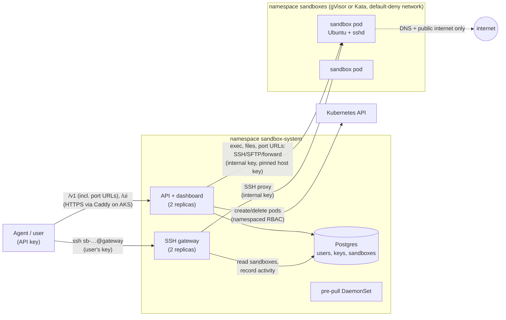

# Sandbox provider

Isolated Linux sandboxes for AI agents, on Kubernetes. An agent with an API
key creates a sandbox, runs commands in it, moves files in and out, opens
URLs to apps it starts there, and can SSH in. Each sandbox is an Ubuntu pod
under **gVisor** (a user-space kernel, the default) or, when the caller asks,
**Kata Containers** (a lightweight VM with its own kernel, on x86 nodes with
nested virtualization). The `ubuntu-docker` image runs Docker inside the
sandbox (build, run, compose with published ports).

**New here? Start with [SUMMARY.md](SUMMARY.md)** (five minutes). Then
[WRITEUP.md](WRITEUP.md) for the trade-offs, [TESTING.md](TESTING.md) to try
it, [docs/REFERENCE.md](docs/REFERENCE.md) for detail, and
[DESIGN.md](DESIGN.md) for the full decision log (D1–D73).

## Quickstart (macOS)

Needs a Mac (Apple Silicon tested) with about 10 GB of free memory and 40 GB
of disk, plus `git`, `curl`, `openssl`, `ssh-keygen` and `python3` (Xcode
command line tools). Clone to a short path (40 characters at most, e.g.
`~/sandbox-provider`; minikube puts a socket in the clone). Nothing is
installed system-wide: tools, caches and the VM live in `./.devenv`.

```bash
./up.sh      # tools, a minikube VM with gVisor, images, the platform, an admin key (~6 min first time)
./demo.sh    # a narrated walkthrough: create, exec, files, SSH, isolation, delete
./down.sh    # stop the VM (./up.sh resumes); --delete removes it, --purge also ./.devenv
```

The admin key is saved to `.devenv/state/admin-api-key` and never printed
(`pbcopy < .devenv/state/admin-api-key`). For the dashboard, run
`source ./env.sh && kubectl -n sandbox-system port-forward svc/sandbox-api 18080:80`
and open <http://localhost:18080/ui>. To see Docker, compose and port URLs
end to end, run `source ./env.sh && ./code/scripts/test-agent-workflow.sh`.
Every test script is listed in [REFERENCE](docs/REFERENCE.md#development-scripts).

## Architecture



- **API + dashboard** (Go): checks API keys (stored hashed), enforces a quota
  per user, creates pods, keeps each sandbox's status in step with its pod,
  reaps expired and idle sandboxes, and runs exec, files and port URLs over
  SSH to the pod with an internal key. The dashboard is rendered on the
  server: create, run a command, delete, API keys, an admin view.
- **SSH gateway** (Go): one address for every sandbox; checks the user's key,
  then proxies to the pod. Stateless, with connection limits.
- **Sandboxes**: `ubuntu-base`, `ubuntu-dev` (Python, Node.js) or
  `ubuntu-docker` (Docker Engine 29, Compose, Buildx), under gVisor or Kata.
  The agent works as `user` with sudo. `/home/user` lives as long as the pod.
- **Guard rails**: an admission policy (only gVisor or Kata, no token, only
  the capabilities needed, no host access, limits required) enforced even
  against our own API; NetworkPolicies (DNS and the public internet only);
  least-privilege Postgres roles.

## API

Every call needs `Authorization: Bearer <api key>`. Errors are
`{"error": "message"}` with a matching status code.

| Call | Does |
|---|---|
| `GET /v1/me` | the key's user: `id`, `name`, `is_admin`, `max_sandboxes` |
| `POST /v1/sandboxes` | create: `{"image": "ubuntu-dev", "ssh_public_key": "ssh-ed25519 …", "ttl_seconds": 3600, "runtime": "gvisor"}` → **201** with the sandbox, `status: "pending"` |
| `GET /v1/sandboxes[?include_ended=true]` | your sandboxes (`{"sandboxes": [...]}`); live ones unless `include_ended` |
| `GET /v1/sandboxes/{id}` | one sandbox; poll until `status` is `running` |
| `POST /v1/sandboxes/{id}/exec` | run a command: `{"command": "pytest -q", "timeout_seconds": 60, "workdir": "proj"}` → `stdout`, `stderr`, `exit_code`, `timed_out`, `truncated`, `duration_ms` |
| `PUT /v1/sandboxes/{id}/files?path=p` | upload the request body to `p` (relative to `/home/user`), up to 100 MiB |
| `GET /v1/sandboxes/{id}/files?path=p` | download `p` as raw bytes |
| `DELETE /v1/sandboxes/{id}` | delete now |
| `ANY /v1/sandboxes/{id}/ports/{port}/{path}` | HTTP to a server inside the sandbox on `port` (e.g. an app started with `docker compose up`); see below |

- **Create:** `image` is `ubuntu-base`, `ubuntu-dev` or `ubuntu-docker`;
  `runtime` is `gvisor` (default) or `kata` (where installed); `ttl_seconds`
  60–86400 (default 3600); `ssh_public_key` is the only key the gateway
  accepts for it.
- **Lifetime:** a sandbox ends on `DELETE`, after 30 minutes idle, or when
  its TTL runs out.
- **Exec:** runs in `bash -c` as `user`, up to 600 s; output capped at 1 MiB
  per stream.
- **Ports:** any method and path, WebSockets too, with the owner's key; the
  key and cookies are stripped before the app sees the request.
- **SSH:** `ssh -i ~/.ssh/KEY sb-<id>@<gateway>`.

Status codes, limits and admin commands: [REFERENCE § API details](docs/REFERENCE.md#api-details).

## Measured

10 sandboxes created at once on Azure AKS (2 × `Standard_D4s_v6`, x86,
4 vCPU / 16 GiB, images pre-pulled), create request to `running`, 3 runs
each (D70):

| 10 at once | p50 | p95 |
|---|---|---|
| gVisor, `ubuntu-base` | 3.0–3.3 s | 3.7–4.3 s |
| gVisor, `ubuntu-docker` (Docker answering) | 3.6–4.0 s | 4.0–5.9 s |
| Kata, `ubuntu-base` | 5.5–5.7 s | 6.1–6.8 s |
| Kata, `ubuntu-docker` (Docker answering) | 16.6 s | 17.7–19.6 s |

A final fresh deployment measured p50 3.2 / 3.2 / 5.1 / 13.8 s in the same
order. On a laptop one sandbox reaches `running` in 1.1 s. Kata with Docker
is CPU-bound when 10 VMs start Docker at once on small nodes. Laptop
numbers, memory per sandbox, pre-pull and the earlier arm64 deployment:
[REFERENCE § Measurements](docs/REFERENCE.md#measurements).

## On Azure (AKS)

Needs an Azure subscription with 8 vCPUs of quota for the node size (a free
account must upgrade to pay-as-you-go first) and the local cluster from
`./up.sh`, which builds the images.

```bash
./code/scripts/bootstrap-cloud-tools.sh      # Terraform + Azure CLI into ./.devenv (once)
source ./env.sh && az login                  # once, in your own terminal
./cloud-up.sh                                # ~15 minutes (plus ~5 the first time); about $0.45/hour
source ./env.sh aks && ./demo.sh             # the same demo and test scripts, against AKS
./cloud-down.sh                              # deletes everything and checks nothing is left
```

That gives two x86 nodes with gVisor and Kata, a public SSH gateway on
port 22, the API and dashboard on `https://sandbox-<id>.<region>.cloudapp.azure.com`
(Let's Encrypt), and an admin key in `.devenv/state/aks/admin-api-key`.
Quotas, node sizes and letting testers in:
[REFERENCE § Azure](docs/REFERENCE.md#azure-aks-in-detail). Installing the
Helm chart on another cluster:
[REFERENCE § Deploying](docs/REFERENCE.md#deploying-to-another-cluster).

## Uninstall

- **Laptop**: `./down.sh --delete` deletes the VM and all data;
  `./down.sh --purge` also removes `./.devenv`, which leaves the clone as
  cloned. It refuses while an Azure cluster from `cloud-up.sh` still
  exists, since its login and state live there: run `./cloud-down.sh` first.
- **Azure**: `./cloud-down.sh` deletes the resource group, cluster and
  registry, and fails if anything billable is left.
- **Any cluster**: `helm uninstall sandbox -n sandbox-system` deletes every
  sandbox and the platform. It keeps the Postgres volume and the generated
  Secrets, so a reinstall keeps users and keys. `kubectl delete namespace
  sandbox-system` removes those too. Some storage provisioners, including
  minikube's, keep a deleted volume's data.
