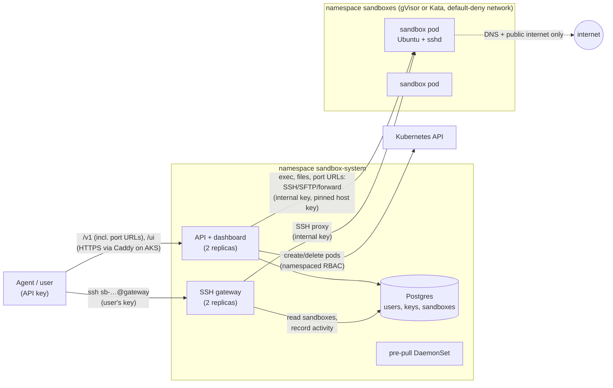

# Sandbox provider

Isolated Linux sandboxes for AI agents, on Kubernetes. An agent with an API
key creates a sandbox, runs commands in it, moves files in and out, and can
SSH in, like a person would. Each sandbox is an Ubuntu pod running under
**gVisor**, a user-space kernel, so code in it never talks to the host's
kernel directly, or, when the caller asks for it, under **Kata
Containers**: a lightweight VM with its own Linux kernel (on clusters with
x86 nodes that support nested virtualization). It is cut off from the
cluster and other sandboxes by NetworkPolicies, and it is deleted when its
owner says so, when it has been idle for 30 minutes, or when its lifetime
runs out. One image, `ubuntu-docker`, runs Docker inside the sandbox (build,
run, compose with published ports).

- **HTTP API** (`/v1`) for agents: create, list, exec, upload, download, delete, and URLs to ports in the sandbox.
- **SSH gateway**: `ssh <sandbox-id>@<gateway>` with the key given at create.
- **Dashboard** (`/ui`): your sandboxes (create, run a command, delete) and API keys; for admins, every user and sandbox.
- **Helm chart** for any cluster with gVisor (and Kata, where installed); scripts for a laptop and for Azure AKS.

Design decisions and the reasons for them are logged in [DESIGN.md](DESIGN.md)
(D1–D72); [WRITEUP.md](WRITEUP.md) covers the trade-offs, scaling and what
comes next; [TESTING.md](TESTING.md) is the guide for testers.

## Quickstart (macOS)

Needs a Mac (Apple Silicon, tested; Intel should work, untested) with about 10 GB of free memory and 40 GB
of disk, plus `git`, `curl`, `openssl`, `ssh-keygen` and `python3` (all part
of macOS with the Xcode command line tools). Clone to a short path (about 40
characters at most, e.g. `~/sandbox-provider`): minikube's VM driver uses a
socket inside the clone, and macOS limits socket paths. Nothing is installed
system-wide: the tools (Go, kubectl, Helm, minikube, vfkit), their caches and
the VM all live in `./.devenv`.

```bash
./up.sh      # tools, a minikube VM with gVisor, images, the platform, an admin key
./demo.sh    # a narrated walkthrough: create, exec, files, SSH, isolation, delete
./down.sh    # stop the VM (./up.sh resumes); --delete removes it, --purge also ./.devenv
```

For Docker, compose and port URLs end to end (what an agent does), run
`source ./env.sh && ./code/scripts/test-agent-workflow.sh`.

`up.sh` took about 6 minutes from a fresh clone (downloads included) and
about 1.5 minutes when run again, measured before the `ubuntu-docker` image
was added; expect a couple of minutes more now. It is safe to re-run after a
code change. The admin API key is saved to `.devenv/state/admin-api-key` and
never printed; copy it with `pbcopy < .devenv/state/admin-api-key`.

Dashboard:

```bash
source ./env.sh && kubectl -n sandbox-system port-forward svc/sandbox-api 18080:80
```

Then open <http://localhost:18080/ui> and sign in with that key (paste it
after the `pbcopy` above).

To work on the code, run `source ./env.sh` (like a Python venv; `deactivate_sandbox_env` undoes it). After that:

| Script | What it does |
|---|---|
| `code/scripts/cluster-up.sh` | minikube (vfkit, containerd, Calico) + gVisor + sandbox images |
| `code/scripts/deploy.sh` | builds the platform image, `helm upgrade --install` |
| `code/scripts/test-db.sh` | all Go tests, including the ones against Postgres |
| `code/scripts/smoke-api.sh` | API end to end (31 checks) |
| `code/scripts/test-gateway-e2e.sh` | SSH gateway end to end, incl. attacks (16 checks) |
| `code/scripts/test-sandbox-hardening.sh` | what code inside a sandbox can and can't do, and the admission policy (39 checks on minikube; 46 on AKS, with the Kata and runc probes) |
| `code/scripts/test-agent-workflow.sh` | agent workflows end to end: an app with Redis, Postgres, a multi-stage Go build, WebSockets through a port URL, Docker storage full (17 checks) |
| `code/scripts/test-ports.sh` | port URLs: proxying, credential stripping, refusals (13 checks) |
| `code/scripts/test-docker.sh` | Docker in an `ubuntu-docker` sandbox: build, run, `-p`, compose with ports, `docker exec`; isolation of nested containers; forged packets stay on the node (23 checks) |
| `code/scripts/test-network-policy.sh` | sandbox network isolation (15 checks on minikube; 18 on AKS, with the load balancer and proxy checks) |
| `code/scripts/load-test.sh N [image]` | N sandboxes at once, startup percentiles |
| `code/scripts/test-prepull.sh`, `measure-prepull.sh` | image pre-pull proof and timing |

Every script that creates sandboxes takes `SANDBOX_RUNTIME=kata` to run them
under Kata (on a cluster with Kata, i.e. AKS); `load-test.sh` too.

## Architecture



- **API** (Go, `code/cmd/api`): authenticates API keys (only hashes are
  stored), enforces each user's quota (10 live sandboxes), creates the pod and
  a per-sandbox host key, and keeps each sandbox's status in step with its pod
  (watch + periodic reconcile). It reaps sandboxes that are expired or idle.
  It runs commands and moves files over SSH/SFTP to the pod using a
  platform-internal key that users never see. It also serves the dashboard,
  rendered on the server.
- **SSH gateway** (Go, `code/cmd/gateway`): one address for every sandbox. It
  checks the user's key against the one stored for that sandbox, then proxies
  the connection to the pod with the internal key, pinning the pod's host
  key. It's stateless and has connection limits per replica, per client and
  per sandbox.
- **Sandboxes**: `ubuntu-base` (git, curl, build tools, sshd), `ubuntu-dev`
  (plus Python 3, Node.js, package managers) or `ubuntu-docker` (plus Docker
  Engine 29, Compose and Buildx: `docker build`, `docker run -p`,
  `docker compose up` work as `user`, without sudo).
  - Runtime: gVisor by default, or Kata (`"runtime": "kata"`), as `root`
    inside the pod with only the capabilities sshd and sudo need. The agent
    works as `user`.
  - `ubuntu-docker` runs under its own gVisor runtime, `gvisor-docker`
    (raw sockets on, 6 more capabilities, granted inside gVisor only), or
    under Kata (the same 6 plus `SYS_RESOURCE` and `SYS_PTRACE`, inside its VM), with 2 CPUs
    and 4 GiB, half of it for Docker's storage, which is in memory.
  - Limits (`ubuntu-base`, `ubuntu-dev`): 1 CPU / 1 GiB memory / 5 GiB disk.
  - Workspace: `/home/user` survives restarts of the process, not loss of the
    pod or its node; a lost sandbox is marked `lost`, not recreated.
- **Guard rails in the cluster**:
  - An admission policy rejects any pod in the sandboxes namespace that
    isn't gVisor or Kata, mounts a token, adds capabilities beyond the ones
    sshd and sudo need (plus Docker's only under `gvisor-docker` or `kata`,
    and `SYS_RESOURCE`/`SYS_PTRACE` only under `kata`), carries Kata annotations, uses
    the host's namespaces, paths or ports, or skips limits, even if the
    request comes from the API.
  - NetworkPolicies let sandboxes reach DNS and the public internet only. Only
    the API and gateway may reach a sandbox, on port 22.
  - Postgres roles keep the API off superuser and limit the gateway to
    reading sandboxes and recording SSH activity.

## API

Every call needs `Authorization: Bearer <api key>`. Errors are
`{"error": "message"}` with a matching status code.

| Call | Does |
|---|---|
| `GET /v1/me` | the key's user: `id`, `name`, `is_admin`, `max_sandboxes` |
| `POST /v1/sandboxes` | create: `{"image": "ubuntu-dev", "ssh_public_key": "ssh-ed25519 …", "ttl_seconds": 3600, "runtime": "gvisor"}` → **201** with the sandbox, `status: "pending"` |
| `GET /v1/sandboxes[?include_ended=true]` | your sandboxes (`{"sandboxes": [...]}`); live ones unless `include_ended` |
| `GET /v1/sandboxes/{id}` | one sandbox; poll until `status` is `running` |
| `POST /v1/sandboxes/{id}/exec` | run a command: `{"command": "pytest -q", "timeout_seconds": 60, "workdir": "proj"}` → `stdout`, `stderr`, `exit_code`, `timed_out`, `truncated`, `duration_ms` |
| `PUT /v1/sandboxes/{id}/files?path=p` | upload the request body to `p` (relative to `/home/user`), up to 100 MiB |
| `GET /v1/sandboxes/{id}/files?path=p` | download `p` as raw bytes |
| `DELETE /v1/sandboxes/{id}` | delete now |
| `ANY /v1/sandboxes/{id}/ports/{port}/{path}` | HTTP to a server inside the sandbox on `port` (e.g. an app started with `docker compose up`); see below |

Notes:

- **Create**
  - `image` is `ubuntu-base`, `ubuntu-dev` or `ubuntu-docker`.
  - `runtime` (optional) is `gvisor` (the default: a user-space kernel,
    fastest start) or `kata` (a lightweight VM with its own Linux kernel,
    the stronger boundary). `kata` exists only where Kata is installed (AKS
    on x86 nodes); elsewhere it's refused with "isn't available on this
    cluster". Every image works under both; responses include `runtime`.
  - `ttl_seconds` runs from 60 to 86400; the default is 3600.
  - `ssh_public_key` is the only key the gateway accepts for this sandbox.
- **Ports** (D66)
  - Any method, any path under the prefix, WebSockets too; the server must
    listen on `127.0.0.1` or `0.0.0.0` inside the sandbox (Docker's
    published ports do). Nothing listening → **502**.
  - Needs the owner's (or an admin's) API key, like every call. The key and
    any cookies are removed before the request reaches the sandbox;
    responses lose `Set-Cookie` and get `Content-Security-Policy: sandbox`.
    The app sees its prefix in `X-Forwarded-Prefix`; a redirect to `/x`
    stays under the prefix. At most 64 requests at once per sandbox
    (429 beyond).
  - It goes over the sandbox's own SSH connection (a forward to its
    loopback), so no other network path to the sandbox exists.
- **Exec**
  - `command` runs in `bash -c` as `user`, who has passwordless `sudo`.
  - `timeout_seconds` can be up to 600 (default 60); a command that runs out
    of time is stopped and returns `timed_out: true` (exit code 124, or 137 if
    it ignored SIGTERM).
  - stdout and stderr are capped at 1 MiB each (`truncated: true`).
- **Lifetime**: a sandbox ends on `DELETE`, after 30 minutes idle, or when
  `ttl_seconds` runs out. Idle means no exec, no file transfer and no SSH
  session; reading its status doesn't count, so an agent that only polls is
  still reaped.
- **Status**:
  - Live: `pending` → `running` (→ `deleting`).
  - Ended: `deleted`, `failed` (couldn't start) or `lost` (the pod disappeared).
  - `status_reason` says why. Ended sandboxes stay listed for history.
- **Status codes**:
  - 400: invalid input.
  - 401: missing, unknown or revoked API key.
  - 403: the sandbox's own file permissions refused a file operation.
  - 404: not yours, no such sandbox, or no such file.
  - 409: not running yet or anymore.
  - 413: upload over 100 MiB.
  - 429: quota reached.
  - 502: the sandbox didn't answer.
  - 503: the cluster is busy.
- **Admins** can do all of this to anyone's sandbox, and see every user and
  sandbox in the dashboard. A first admin is made with
  `kubectl -n sandbox-system exec deploy/sandbox-api -- /api create-user --name <name> --admin`
  (it prints the key once); `create-key --user <name>` issues more keys.

SSH:

```bash
source ./env.sh && ssh -i ~/.ssh/KEY -p 30022 sb-1a2b3c4d5e6f@$(minikube ip)   # minikube NodePort
ssh -i ~/.ssh/KEY sb-1a2b3c4d5e6f@gateway.example.com                           # behind a LoadBalancer
```

To pin the gateway's host key instead of trusting the first connection:
`kubectl -n sandbox-system exec deploy/sandbox-gateway -- /api public-key /keys/host/ssh_host_ed25519_key`
prints it (`ssh-ed25519 AAAA…`). Put `[host]:port ` in front of it for a
`known_hosts` line; `deploy.sh` prints the whole line.

## Measured

On a MacBook (minikube VM with 4 CPUs and 8 GB, vfkit, gVisor), images
already on the node:

| What | Time |
|---|---|
| One sandbox, create → `running` | **1.1 s** (first exec 1.2 s) |
| 10 at once, `ubuntu-base`, → `running` | **p50 2.5–2.8 s, p95 3.6–4.7 s** (10/10; the create request 0.1 s, D68) |
| … before the client rate-limit fix (D48) | p50 2.4 s, p95 4.4 s; `ubuntu-dev` p50 3.1 s, p95 4.3 s |
| First `ubuntu-dev` sandbox on a node **without** the pre-pull | ~5.5 s (4.8–5.1 s of it is the image download + unpack, from a registry on the same VM) |
| … **with** the pre-pull DaemonSet | 0.6 s |
| `up.sh` from a fresh clone / again (VM stopped), before `ubuntu-docker` | 305–367 s / 84 s |
| `deploy.sh` (platform image build + `helm upgrade --install`) on a cluster with gVisor and images | ~20 s |

Capacity on this VM is about 10 sandboxes (250m CPU requested each); past
that, creates succeed but stay `pending` until room frees up (D48). The
download time is a lower bound: from a real registry it is
bandwidth-bound, which is why the images are pre-pulled on every node
(D46, D51).

On **Azure AKS with both runtimes** (2 × `Standard_D4s_v6`, x86, 4 vCPU /
16 GiB, gVisor and Kata; images pre-pulled; 3 runs of each), D70. Time from
the create request to `running`, 10 sandboxes created at once, all 10
running every time:

| 10 at once | p50 | p95 |
|---|---|---|
| gVisor, `ubuntu-base` | 3.0–3.3 s | 3.7–4.3 s |
| gVisor, `ubuntu-docker` (Docker answering) | 3.6–4.0 s | 4.0–5.9 s |
| Kata, `ubuntu-base` | 5.5–5.7 s | 6.1–6.8 s |
| Kata, `ubuntu-docker` (Docker answering) | 16.6 s (each run) | 17.7–19.6 s |

| Other | |
|---|---|
| One sandbox alone: gVisor / Kata, `ubuntu-docker` | ~3 s / ~4 s |
| The create request itself (all of the above) | p50 0.3–0.5 s |
| Host memory per idle `ubuntu-base` sandbox (RSS of its processes on the node): gVisor / Kata | ~90 MiB / ~250 MiB |
| `./cloud-up.sh` from nothing (2 nodes, gVisor and Kata, amd64 images cached) | 884–975 s |

Kata with Docker at 10 at once is the outlier: starting Docker in 10 VMs at
once on 8 vCPUs of nested virtualization is CPU-bound (dockerd took 8–12 s
to answer in each VM; ~1.75 s in an otherwise idle VM). It was 26–27 s
before Docker's nftables backend replaced its few hundred `iptables` calls
(D70). Bigger nodes or a warm pool are the fix.

A later fresh deployment (the final check before submission) measured, 10 at
once: gVisor p50 3.2 s / p95 3.6 s, with Docker 3.2 / 3.8 s; Kata 5.1 / 5.9 s,
with Docker 13.8 / 14.4 s. `cloud-up.sh` took 884 s.

An **earlier deployment**, gVisor only (2 × `Standard_D2ps_v5`, arm64, 2 vCPU /
8 GiB; images pre-pulled from the cluster's registry), D56. Kept for the
cold-node pre-pull numbers:

| What | Time |
|---|---|
| `./cloud-up.sh` from nothing (cluster, gVisor, images, install) / `./cloud-down.sh` | 581 s (633 s on the run before the fixes) / 378–394 s |
| Pre-pull from the registry onto a fresh node: `ubuntu-dev` (218 MB) / `ubuntu-base` (145 MB) | **7.6–9.3 s** / 4.6–8.1 s |
| One sandbox, create → `running` | 3.1 s (first exec 3.4 s) |
| 10 at once → 7 running: `ubuntu-base` / `ubuntu-dev` | p50 3.7 s, p95 5.2 s / p50 3.8 s, p95 4.8 s |

On those small nodes only 7 of 10 fit: of the 3.8 allocatable vCPUs, AKS's own system pods
request 1.26 and the platform 0.42, leaving 0.97 and 1.13 on the two nodes,
room for 3 + 4 sandboxes at 250m each; the other 3 stay `pending` until
room frees up. More or larger nodes (or the cluster autoscaler) raise that.

## On Azure (AKS)

Needs:

- **An Azure subscription with 8 vCPUs of quota** in the region for the node
  size's family (2 x86 `Standard_D4s_v6` nodes, which have nested
  virtualization for Kata). A free account starts at 4 and can't raise it:
  upgrade to pay-as-you-go (the credit still applies), then check
  Quotas → Compute. If one family's increase is refused (DSv5 was, here),
  pick a size whose family already has quota with `AZURE_NODE_SIZE`; the
  quota check says which before anything is created.
  `AZURE_NODE_SIZE=Standard_D2ps_v5` gives 2 small arm64 nodes, gVisor only.
- **The local cluster from `./up.sh`**, which builds the images. For x86
  nodes `cloud-up.sh` builds amd64 images on it under QEMU emulation, about
  5 minutes the first time (D63).

Node size and count are remembered only while the cluster exists.

```bash
./code/scripts/bootstrap-cloud-tools.sh      # Terraform + Azure CLI into ./.devenv (once)
source ./env.sh && az login                  # once, in your own terminal
./cloud-up.sh                                # ~15 minutes (plus ~5 the first time); about $0.45/hour while it exists*
source ./env.sh aks && ./demo.sh             # the same demo and test scripts, against AKS
./cloud-down.sh                              # deletes everything and checks nothing is left
```

\* An estimate for 2 × `Standard_D4s_v6` pay-as-you-go in West US 2, plus
disks and public IPs; the AKS control plane (Free tier) costs nothing.

`cloud-up.sh` checks the login, the region's quota and that the node size
is offered, creates the cluster and registry with Terraform (Kubernetes API
open to your IP only), installs gVisor on the nodes
(`code/deploy/cloud/gvisor-installer.yaml`) and, on x86 nodes, Kata
Containers (`kata-deploy`, `code/deploy/cloud/kata-values.yaml`), pushes the
images, and installs the chart. That gives:

- a public SSH gateway on port 22;
- the API and dashboard on **`https://sandbox-<id>.<region>.cloudapp.azure.com`**,
  with a Let's Encrypt certificate, served by Caddy in front of the API;
- an admin key in `.devenv/state/aks/admin-api-key` (copy it with `pbcopy <`
  that path to sign in to the dashboard).

`source ./env.sh aks` / `source ./env.sh local` switch kubectl, `demo.sh`
and the test scripts between the two clusters.

### Letting testers in

1. **Optionally limit who can connect:**
   `ALLOWED_CIDRS="203.0.113.0/24,198.51.100.7/32" ./cloud-up.sh`. Only those
   ranges, plus your own IP, can then reach the HTTPS API, the dashboard and
   the SSH gateway; others get 403 (HTTPS) or no connection (SSH). Without
   it, anyone can connect but still needs a key.
   - **To change it during a session:**
     `ALLOWED_CIDRS="..." ./cloud-up.sh --allowlist-only` (`none` opens it
     up). Nothing is rebuilt and testers' sessions keep running.
   - **Settings are remembered:** a plain re-run of `./cloud-up.sh` (which
     redeploys the code and ends SSH sessions) keeps the last allowlist,
     region and size, and refuses changing region, name or node size/count on a running cluster.
2. **Give each tester their own key:**
   `source ./env.sh aks && ./code/scripts/add-tester.sh alice`. That writes
   the key to `.devenv/state/aks/testers/alice.key` (it isn't printed). Send
   it through a password manager share, not chat or email, then delete the
   file.
3. **Send them [TESTING.md](TESTING.md)** with the HTTPS address and the SSH
   gateway address (both printed by `cloud-up.sh`). For a checked first SSH
   connection, also send the gateway's `known_hosts` line (in an `aks` shell;
   GATEWAY_IP is the SSH address):
   `echo "GATEWAY_IP $(kubectl -n sandbox-system exec deploy/sandbox-gateway -- /api public-key /keys/host/ssh_host_ed25519_key | cut -d' ' -f1,2)"`.
4. **Watch:** the admin dashboard (`/ui/admin`, with your key) shows every
   user and sandbox.
5. **End someone's access:**
   `source ./env.sh aks && ./code/scripts/add-tester.sh --revoke alice`
   (revokes their keys, quota 0; the script prints which cluster it acted
   on). Adding the same name again gives them a
   new key and their quota back. Then `./cloud-down.sh` when the session is
   over: it all costs about $0.45/hour while it runs.

Let's Encrypt issues at most 5 certificates a week for one name, and each
`cloud-up.sh` after a `cloud-down.sh` needs a new one. Past that,
`AZURE_DNS_LABEL=sandbox-<new> ./cloud-up.sh` uses another address.

## Deploying to another cluster

The chart in `code/deploy/helm` needs:

- **gVisor with two handlers on every node:** `runsc` (RuntimeClass
  `gvisor`) and `runsc-docker` with `net-raw` and `allow-packet-socket-write`
  (RuntimeClass `gvisor-docker`, for `ubuntu-docker`). The chart can't install
  node software. Use `code/scripts/install-gvisor.sh` (minikube) or the
  installer DaemonSet in `code/deploy/cloud/gvisor-installer.yaml` (used on
  AKS; it handles containerd 1.x and 2.x config formats and rolls back a
  config containerd won't load), which set up both.
- **Kata (optional):** `kata-deploy` with `code/deploy/cloud/kata-values.yaml`
  on x86 nodes with nested virtualization, then
  `--set 'sandboxRuntimes={gvisor,kata}'`.
- **A CNI that enforces NetworkPolicies.**
- **The images in a registry the nodes can pull from.** That's the platform
  image (`code/Dockerfile`) and the three sandbox images
  (`code/images/sandbox`, targets `base`, `dev` and `docker`, tagged
  `sandboxImages.tag`, now `0.3`).

```bash
helm upgrade --install sandbox code/deploy/helm -n sandbox-system --create-namespace \
  --set image.repository=REGISTRY/sandbox/api --set image.tag=TAG \
  --set sandboxImages.repository=REGISTRY/sandbox/ \
  --set gateway.service.type=LoadBalancer \
  --set api.sshGatewayAddr=GATEWAY_HOST
```

Values (`values.yaml`) also cover replicas, resources, sandbox TTL and idle
limits, gateway connection limits, Postgres storage, and the egress ranges
sandboxes may not reach. If the `kubernetes` Service forwards to a public
address (as on AKS), the chart blocks it for sandboxes automatically, as of
the install or last upgrade (re-run the upgrade if the control plane's IP
changes; `test-network-policy.sh` checks it). A public API endpoint that
isn't behind that Service (possibly EKS) goes in
`networkPolicies.extraBlockedRanges`. Passwords and keys are generated on first install
and kept across upgrades. Install only with `helm upgrade --install`, not
`helm template`. For a public HTTPS address, either use your own Ingress
and TLS, or turn on the chart's Caddy front: `publicApi.enabled=true`,
`publicApi.host=<a DNS name pointing at its load balancer>`, and optionally
`publicApi.allowedSourceRanges`.

## Uninstall

- **Laptop**: `./down.sh --delete` deletes the VM and all data;
  `./down.sh --purge` also removes `./.devenv`, which leaves the clone as
  cloned. It refuses while an Azure cluster from `cloud-up.sh` still
  exists, since its login and state live there: run `./cloud-down.sh` first.
- **Azure**: `./cloud-down.sh` deletes the resource group, cluster and
  registry, and fails if anything billable is left.
- **Any cluster**: `helm uninstall sandbox -n sandbox-system` deletes every
  sandbox and the platform. It keeps the Postgres volume and the generated
  Secrets, so a reinstall keeps users and keys. `kubectl delete namespace
  sandbox-system` removes those too. Some storage provisioners, including
  minikube's, keep a deleted volume's data.
